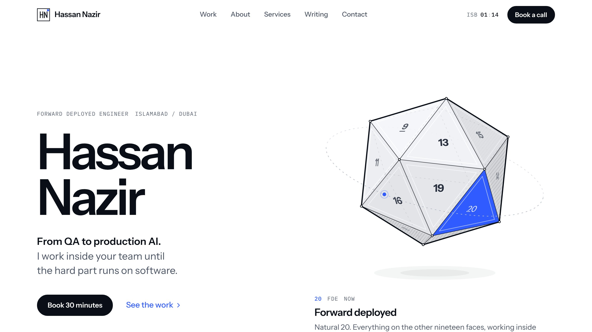

# Hassan Nazir: portfolio and field notes

The source for [hassannazir.dev](https://hassannazir.dev): my portfolio, services pages and engineering blog. I'm a forward deployed engineer, currently AI Environment Engineer at Outsentia, ML Researcher at Anthology and AI Architect at Uno OS.



## What is in here

- **Pages**: `/`, `/about`, `/work`, `/work/:slug`, `/services`, `/services/:slug`, `/blogs`, `/blogs/:slug` and `/contact`. Work, career and quick-answer content each come from one JSON file in `src/data/`.
- **Blog**: 75 field notes as `.mdx` files in `data/blog/`, indexed at build time with `import.meta.glob` and `gray-matter`. Posts support KaTeX maths, syntax-highlighted code blocks, GitHub-style callouts and a table of contents.
- **Interactive SVG, written by hand**: the d20 on the home page, the career git graph, the career timeline, the stack diagram and a glyph for each public repo and service.
- **Comments**: guest comments stored locally, or GitHub Discussions through Giscus.
- **Booking**: a Calendly drawer for 30 minute calls, themed for light and dark mode.
- **Search and AI crawlers**: 99 static HTML route shells with JSON-LD, plus `sitemap.xml`, RSS, Atom and JSON feeds, `llms.txt`, `portfolio.json`, an agent catalog and WebMCP tools (`src/utils/webmcp.ts`).

## Design

One white canvas, ink `#0A0F17` for type and one blue accent, `#2F5BFF`.

- **Type**: Instrument Sans for text, with headings at weight 600 and tight tracking. IBM Plex Mono for labels, dates and numbers. Both are self-hosted in `public/fonts/`.
- **Layout**: sections are separated by space. There are no grey bands, card borders or shadows. Hairlines appear only inside lists and tables.
- **Sections**: a headline, one short line and one action. A quiet link (`See the work ›`) is the second action where one is needed.
- **Shape**: 8px, 14px and 22px corner radii; buttons and tags are pills.
- **Graphics**: the d20, the glyphs and the diagrams sit straight on the page with no frame behind them.
- **Footer**: always dark, and it holds the theme switch.
- **Dark mode**: neutral greys with no blue cast. It follows the system setting until a visitor picks a theme.

The tokens and every component style live in `src/components/hn/hn.css`. The blog pages use Tailwind for layout and read the same tokens.

## Stack

| Area | Tools |
|---|---|
| App | React 18, TypeScript, Vite, React Router |
| Styling | Scoped CSS (`hn.css`), Tailwind CSS on the blog pages, Framer Motion for the booking drawer |
| Content | MDX, gray-matter, react-markdown, remark-gfm, remark-math, rehype-katex |
| Integrations | Calendly, EmailJS, Giscus |
| Build scripts | Route shells, feeds and sitemap, LLM and agent files, share images, IndexNow |

## Run it locally

```bash
git clone https://github.com/zimkk/portfolio.git
cd portfolio
npm install
npm run dev
```

The contact form and Giscus comments need keys. Copy `.env.example` to `.env` and fill them in; the site runs without them, and the form falls back to a `mailto:` link.

## Scripts

| Command | What it does |
|---|---|
| `npm run dev` | Starts the Vite dev server |
| `npm run build` | Builds the bundle, then generates the route shells, search index, feeds, sitemap and the LLM and agent files in `public/` and `dist/` |
| `npm run preview` | Serves the production build |
| `npm run lint` | Runs ESLint |
| `npm run og:images` | Renders 1200x630 share images into `public/images/og/`. Add `-- --force` to re-render existing ones |
| `npm run screenshots` | Captures the project screenshots used on the work pages |
| `npm run seo:submit` | Submits URLs to IndexNow |

## Write a post

Add an `.mdx` file to `data/blog/`:

```yaml
---
title: "Your article title"
seoTitle: "Optional shorter search title, 60 characters or fewer"
publishedAt: '2026-09-03'
category: "Forward Deployed Engineering"
readTime: '10 min read'
excerpt: "Two sentences: the problem and what you did about it."
tags: ["Forward Deployed Engineering", "Enterprise AI"]
seoKeywords: ["Keyword 1", "Keyword 2"]
image: '/images/forward-deployed-services.svg'
---

# Your article title

Markdown or MDX, with LaTeX maths ($E=mc^2$), code fences and callouts.
```

The next build adds the route, the search entry, the feeds and the SEO metadata. Run `npm run og:images` to create its share image, and commit the output.

## Credits

- [Timothy Lin](https://github.com/timlrx)'s [tailwind-nextjs-starter-blog](https://github.com/timlrx/tailwind-nextjs-starter-blog), which shaped the blog layout, the tag pages and the feeds.
- [Instrument Sans](https://github.com/Instrument/instrument-sans) and [IBM Plex Mono](https://github.com/IBM/plex), both under the SIL Open Font License.
- [Giscus](https://giscus.app), [KaTeX](https://katex.org), [Calendly](https://calendly.com) and [Lucide](https://lucide.dev).

## License

MIT. See [`LICENSE`](./LICENSE).
